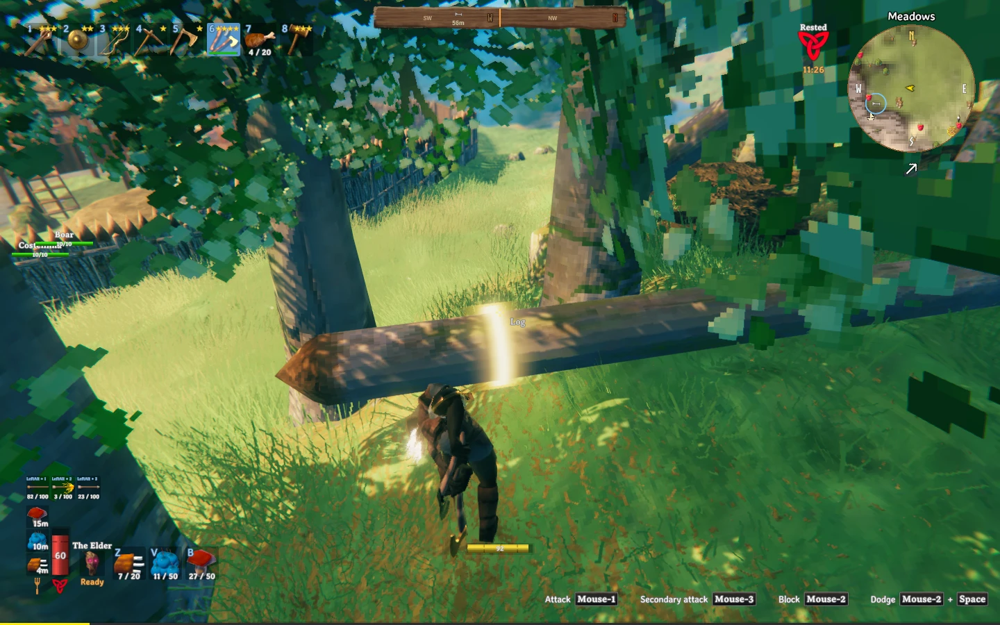
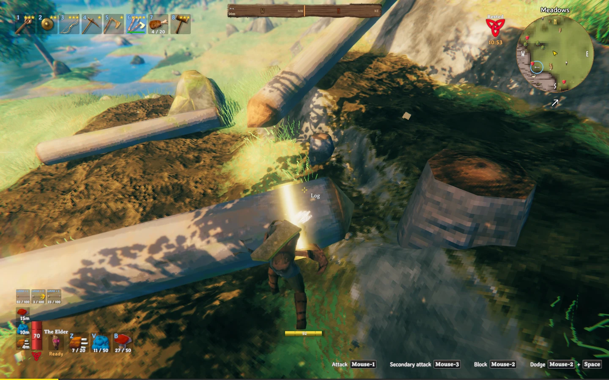
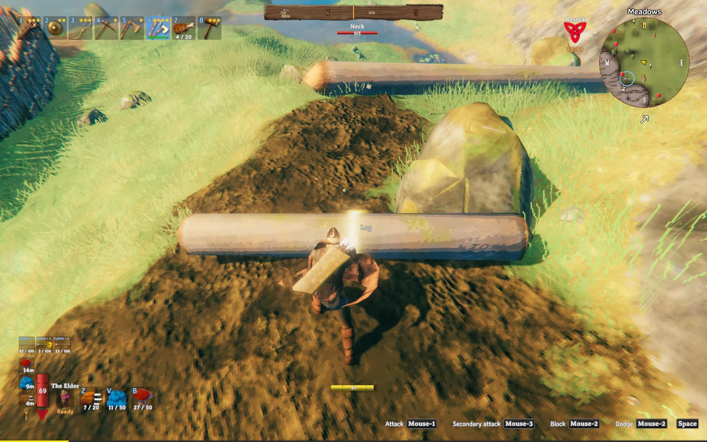
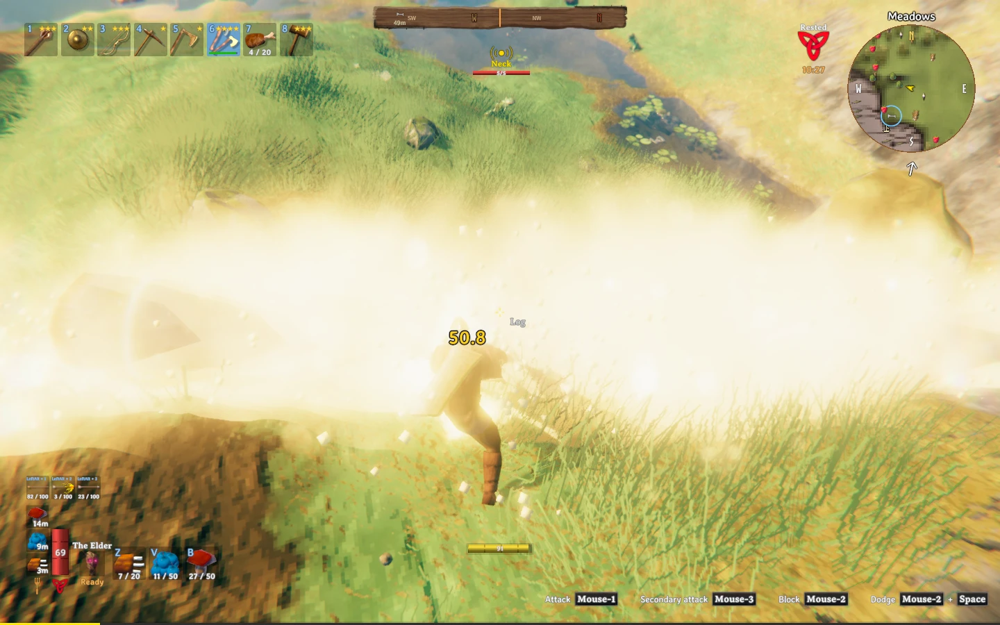

# Tree Weak Spots

**[English](#english) · [Português](#português)**

---

## English

A client-side Valheim mod that makes chopping fallen logs a matter of aim. When you aim at a fallen log with an axe, a glowing band wraps around it, like a lit slice of the trunk. Chop on the band and the swing becomes a **critical hit** (2x damage by default), with a flash, a big yellow damage number and a sound.

- **Client-side only:** the server and other players do **not** need the mod.
- **Fallen logs only.** Standing trees, stumps and everything else work as usual.
- The band fades in, pulses, fades out and moves to another part of the log every few seconds. It follows the log if it rolls.
- **Overhead swing:** after your first normal swing on a log, the next swings on it use the sledgehammer's overhead strike. When the log splits, its pieces keep the overhead swing. Other players see it too, since the animation is part of the game.
- Needs a free off hand: with a shield, torch or any other item in the off hand, the mod stays off. Two-handed axes always work.

### Requirements

- BepInExPack Valheim.

### Installation

**r2modman / Thunderstore Mod Manager:** install from Thunderstore. To install a downloaded zip instead, go to Settings → *Import local mod*.

**Manual:**
1. Extract the zip.
2. Copy the `plugins/TreeWeakSpots` folder into `Valheim/BepInEx/plugins/`.
   Result: `Valheim/BepInEx/plugins/TreeWeakSpots/TreeWeakSpots.dll`.
3. Launch the game.

To update, delete the old `TreeWeakSpots` folder before copying the new one.

### Configuration

Press **F1** in game (requires Configuration Manager) or edit `BepInEx/config/felih.TreeWeakSpots.cfg`. The option names are in Portuguese:

| Option | Default | What it does |
|---|---|---|
| Ativado | on | Enables/disables the mod. |
| MultiplicadorCritico | 2 | Damage multiplier when you chop on the band. |
| Quantidade | 1 | Bands at the same time (1–4). |
| DistanciaEntrePontos | 1.2 m | Minimum distance between bands. |
| ToleranciaDeAcerto | 0.35 m | How close to the band's center (along the log) the swing must land. |
| DuracaoDoPonto | 5 s | Time before a band moves. |
| DistanciaMaxima | 8 m | Max distance from your eyes where a band can appear. |
| TempoSemMirar | 3 s | Time without aiming before the band disappears. |
| Cor | Dourado | Gold (Dourado), blue (Azul) or green (Verde). |
| LarguraDaFaixa | 0.3 m | Width of the band. |
| VolumeDoSom | 1 | Crit sound volume (0 = off). |
| SomDoCritico | Automatico | Automatico, Arquivo (file), Jogo (game), Mod or Nenhum (none). |
| CorDoNumeroCritico | Amarelo | Color of the crit damage number: Amarelo (yellow), Vermelho (red) or Normal. |
| TamanhoDoNumeroCritico | 2 | Size of the crit damage number (2 = double, 1 = unchanged). |
| GolpeDeMarreta | on | Overhead sledge swing on fallen logs. |
| ArmaDaAnimacao | SledgeStagbreaker | Item the swing animation is copied from. |
| ComboChoppingSoEmArvoresEmPe | on | With ComboChopping installed, it keeps working on standing trees but stops touching fallen logs. |

### Custom sound

Drop `.wav` or `.ogg` files into `BepInEx/plugins/TreeWeakSpots/SFX`. With `SomDoCritico` set to `Automatico` or `Arquivo`, one of them is picked at random on each crit. Without files, the mod plays the game's own sound for hitting a staggered enemy.

### Notes

- Works well with **Ore Weak Spots** (same author), the same idea for mining.
- On servers with rules or anti-cheat, let the owner know: this mod increases your axe damage on logs.

---

## Português

Mod client-side para Valheim que transforma o corte de troncos caídos numa questão de mira. Ao mirar num tronco caído com o machado, uma faixa de luz contorna o tronco, como uma fatia acesa. Golpear em cima da faixa dá **dano crítico** (2x por padrão), com clarão, número de dano grande e amarelo e som.

- **Só no seu jogo:** o servidor e os outros jogadores **não** precisam ter o mod.
- **Só em troncos caídos.** Árvores em pé, tocos e o resto continuam normais.
- A faixa surge com fade, pulsa, some e muda para outro ponto do tronco a cada poucos segundos. Ela acompanha o tronco se ele rolar.
- **Golpe de cima para baixo:** depois do primeiro golpe normal num tronco, os próximos golpes nele usam a martelada da marreta. Quando o tronco se parte, as toras continuam com a martelada. Os outros jogadores também veem o golpe, porque a animação já existe no jogo.
- Precisa da mão secundária livre: com escudo, tocha ou outro item nela, o mod fica desligado. Machados de duas mãos sempre funcionam.

### Requisitos

- BepInExPack Valheim.

### Instalação

**r2modman / Thunderstore Mod Manager:** instale pelo Thunderstore. Para instalar um zip baixado, use Configurações → *Import local mod*.

**À mão:**
1. Extraia o zip.
2. Copie a pasta `plugins/TreeWeakSpots` para dentro de `Valheim/BepInEx/plugins/`.
   Resultado: `Valheim/BepInEx/plugins/TreeWeakSpots/TreeWeakSpots.dll`.
3. Abra o jogo.

Para atualizar, apague a pasta `TreeWeakSpots` antiga antes de copiar a nova.

### Configuração

Aperte **F1** no jogo (precisa do Configuration Manager) ou edite `BepInEx/config/felih.TreeWeakSpots.cfg`.

| Opção | Padrão | O que faz |
|---|---|---|
| Ativado | ligado | Liga/desliga o mod. |
| MultiplicadorCritico | 2 | Multiplicador do dano ao golpear a faixa. |
| Quantidade | 1 | Faixas ao mesmo tempo (1 a 4). |
| DistanciaEntrePontos | 1,2 m | Distância mínima entre faixas. |
| ToleranciaDeAcerto | 0,35 m | Quão perto do centro da faixa (ao longo do tronco) o golpe precisa cair. |
| DuracaoDoPonto | 5 s | Tempo até a faixa mudar de lugar. |
| DistanciaMaxima | 8 m | Até que distância dos olhos a faixa surge. |
| TempoSemMirar | 3 s | Tempo sem mirar até a faixa sumir. |
| Cor | Dourado | Dourado, Azul ou Verde. |
| LarguraDaFaixa | 0,3 m | Largura da faixa. |
| VolumeDoSom | 1 | Volume do som de crítico (0 desliga). |
| SomDoCritico | Automatico | Automatico, Arquivo, Jogo, Mod ou Nenhum. |
| CorDoNumeroCritico | Amarelo | Cor do número de dano do crítico: Amarelo, Vermelho ou Normal. |
| TamanhoDoNumeroCritico | 2 | Tamanho do número de dano do crítico (2 = o dobro, 1 = sem mudança). |
| GolpeDeMarreta | ligado | Martelada de cima para baixo nos troncos caídos. |
| ArmaDaAnimacao | SledgeStagbreaker | Item de onde a animação do golpe é copiada. |
| ComboChoppingSoEmArvoresEmPe | ligado | Com o ComboChopping instalado, ele continua nas árvores em pé, mas não mexe nos troncos caídos. |

### Som próprio

Coloque arquivos `.wav` ou `.ogg` na pasta `BepInEx/plugins/TreeWeakSpots/SFX`. Com `SomDoCritico` em `Automatico` ou `Arquivo`, o mod sorteia um deles a cada crítico. Sem arquivos, ele usa o som do jogo de acertar inimigo de postura quebrada.

### Observações

- Combina com o **Ore Weak Spots** (mesmo autor), a mesma ideia para a mineração.
- Em servidores com regras ou anti-cheat, avise o dono: o mod aumenta o dano do machado nos troncos.
